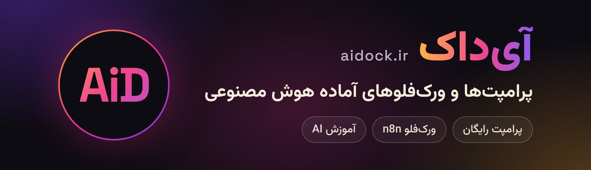
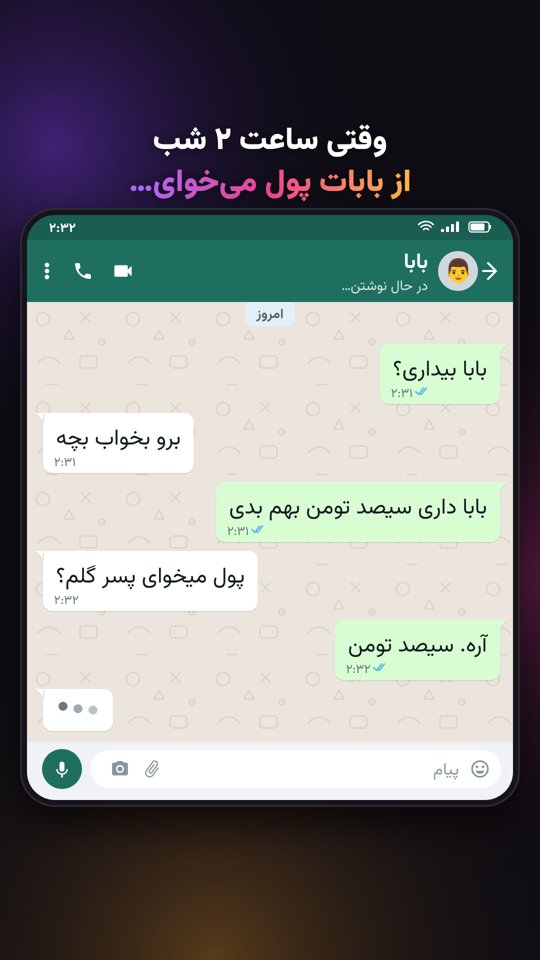

  

  
  
  

## سلام، اینجا آی‌داکه 👋

**[آی‌داک](https://aidock.ir)** گالری فارسیِ پرامپت‌ها، ورک‌فلوها و ابزارهای آماده‌ی هوش مصنوعیه؛ برای تولیدکننده‌های محتوا، طراح‌ها، برنامه‌نویس‌ها و هر کسی که می‌خواد با هوش مصنوعی سریع‌تر و خلاقانه‌تر کار کنه.

- 🎨 **پرامپت‌های آماده:** تصویرسازی، ویدیو، تولید محتوا، بازاریابی، برنامه‌نویسی و…
- ⚡ **ورک‌فلو و اتوماسیون:** ورک‌فلوهای آماده‌ی n8n
- 🛠 **ابزارهای رایگان:** ابزارهای کوچک و کاربردی که مستقیم توی مرورگر کار می‌کنن

## 🛠 ابزارهای رایگان

<table>
<tr>
<td width="260"></td>
<td>

### [چت‌ساز آی‌داک](https://github.com/aidock-ir-dev/aidock-chat-maker)
ساخت ویدیوی چت برای ریلز و شورتس، مستقیم در مرورگر.

- ۳ سبک چت با حالت روشن و تاریک
- زمان‌بندی پیام‌ها و «در حال نوشتن…»
- ۱۹ افکت صوتی، ۴ افکت تصویری، ۵ موزیک بدون کپی‌رایت
- خروجی MP4، بدون نصب و بدون اینترنت

</td>
</tr>
</table>

ابزارهای بیشتری در راهه؛ ⭐ بزن تا خبردار بشی.

## 📬 در ارتباط باشیم

- 🌐 سایت: [aidock.ir](https://aidock.ir)
- 📺 یوتیوب: [@aidock_ir](https://www.youtube.com/@aidock_ir)
- 📸 اینستاگرام: [@aidock.ir](https://instagram.com/aidock.ir)

---

<b>AiDock</b> — a Persian gallery of ready-to-use AI prompts, workflows and free browser tools. <a href="https://aidock.ir">aidock.ir</a>

